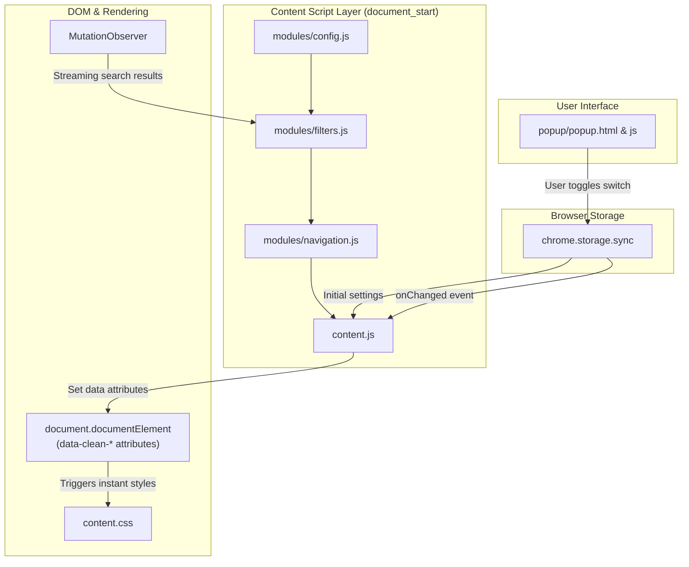

# 📖 Clean Google Search — Developer & Maintenance Handbook

Welcome to the **Clean Google Search** handbook! This guide provides an in-depth walkthrough of the extension's architecture, security boundaries, file structure, and step-by-step instructions for modifying and extending the codebase.

---

## 📑 Table of Contents

1. [Architecture Overview](#1-architecture-overview)
2. [Project File Map](#2-project-file-map)
3. [Safety & Isolation Model](#3-safety--isolation-model)
   - [Protecting the Google Account](#protecting-the-google-account)
   - [Protecting the Top Settings Gear Button & Drawers](#protecting-the-top-settings-gear-button--drawers)
4. [Deep Dive: File by File](#4-deep-dive-file-by-file)
   - [`manifest.json`](#manifestjson)
   - [`content.css`](#contentcss)
   - [`modules/config.js`](#modulesconfigjs)
   - [`modules/filters.js`](#modulesfiltersjs)
   - [`modules/navigation.js`](#modulesnavigationjs)
   - [`content.js`](#contentjs)
   - [`popup/` (HTML, CSS, JS)](#popuph-css-js)
5. [How to Edit & Extend (Cookbook)](#5-how-to-edit--extend-cookbook)
   - [How to Add a New Filter Toggle](#recipe-1-adding-a-new-filter-toggle)
   - [How to Change Keyboard Shortcuts](#recipe-2-customizing-keyboard-shortcuts)
   - [How to Adjust Link Highlight Styling](#recipe-3-customizing-the-active-link-highlight)
6. [Debugging with Chrome DevTools](#6-debugging-with-chrome-devtools)
7. [Publishing to GitHub](#7-publishing-to-github)

---

## 1. Architecture Overview

Clean Google Search uses a **Zero-Flicker, CSS-Driven Architecture**:



### Why This Architecture?
1. **Zero-Flash of Content (No FOUC)**: Because `content_scripts` runs at `document_start`, settings are applied to `<html>` attributes before the browser paints the first frame.
2. **Instant Live Toggles**: When you toggle a setting in the popup, the content script receives the event via `chrome.storage.onChanged` and immediately updates `document.documentElement.dataset`. The CSS immediately shows or hides the target element with **zero page reload**.
3. **Low CPU Overhead**: CSS selectors hide the bulk of unwanted widgets natively inside the Chromium rendering engine. JavaScript only performs light checks for dynamic text headings.

---

## 2. Project File Map

```
clean_google_search/
├── manifest.json            # Extension metadata, permissions & script registration
├── content.css              # Data-attribute scoped CSS hiding rules
├── content.js               # Content script orchestrator (event loop & observer)
├── modules/
│   ├── config.js            # Default settings, constants & protection whitelist
│   ├── filters.js           # Dynamic DOM filter engine & safe element hider
│   └── navigation.js        # Vim-style (j/k) keyboard navigation engine
├── popup/
│   ├── popup.html           # Settings popup interface layout
│   ├── popup.css            # Dark mode styles & custom iOS-style toggles
│   └── popup.js             # Popup event handlers & chrome.storage synchronization
├── icons/
│   ├── icon16.png           # 16x16 toolbar icon
│   ├── icon48.png           # 48x48 extension management icon
│   └── icon128.png          # 128x128 Chrome Web Store icon
├── HANDBOOK.md              # This developer handbook
├── README.md                # Public GitHub project documentation
├── LICENSE                  # MIT License
└── .gitignore               # Excludes temporary and OS files
```

---

## 3. Safety & Isolation Model

### Protecting the Google Account
- **Zero Account Permissions**: `manifest.json` does not request `cookies`, `webRequest`, `identity`, or background service workers.
- **Header Isolation**: The entire Google Bar header is marked as `#gb`. The extension checks `node.closest('#gb')` before performing any hide action.

### Protecting the Top Settings Gear Button & Drawers
Google Search features a "Quick settings" gear icon at the top right, as well as popup dialogs for Search History, SafeSearch, Dark Theme, and Language settings.

To ensure this button and its menus **never break or disappear**:
1. **JavaScript Whitelist (`modules/config.js`)**:
   ```javascript
   CleanSearch.PROTECTED_SELECTORS = [
       '#gb',                     // Entire top Google Bar
       'header',                  // Header container
       '#searchform',             // Search bar input form
       '#tsf',                    // Form element
       '[role="banner"]',         // Page banner
       '[role="dialog"]',         // Settings side panel / modal dialogs
       '[role="menu"]',           // Dropdown menus
       '[aria-label*="settings" i]', // Quick settings gear button & panel
       '#c-b-p',                  // Google quick settings slide-out panel
       '#hdtb-tls',               // Search tools button
       '#hdtbMenus'               // Search tools menu dropdowns
   ].join(', ');
   ```
2. **CSS Exclusion Rule (`content.css`)**:
   Every hiding rule in `content.css` ends with:
   ```css
   :not(
       #gb, #gb *,
       header, header *,
       #searchform, #searchform *,
       [role="dialog"], [role="dialog"] *,
       [role="menu"], [role="menu"] *,
       [aria-label*="settings" i], [aria-label*="settings" i] *,
       #c-b-p, #c-b-p *
   )
   ```
   This rule makes it mathematically impossible for any CSS rule in this extension to target the settings gear or its dialog windows.

### Protecting Organic Search Results & Wikipedia Knowledge Panels
To ensure every relevant organic result link and Wikipedia sidebar summary never vanishes:
1. **Core Container Blacklist (`NEVER_HIDE_IDS`)**:
   `search`, `rso`, `rcnt`, `center_col`, `rhs`, `cnt`, `main` can never be hidden.
2. **Absolute Organic Result Protection (`div.g, div.g *`)**:
   - Every CSS hiding rule explicitly appends `:not(..., div.g, div.g *)`, making it impossible for the style engine to hide organic search results.
   - `CleanSearch.hideElement` checks `el.matches('div.g') || el.querySelector('div.g')` and immediately aborts if an element is or holds an organic result.
   - `getTopResultBlock` checks `curr.querySelectorAll('div.g').length === 0` to ensure an organic result block is never wrapped into a hiding target.
3. **Wikipedia Guard**:
   Any element containing a link to `wikipedia.org` (the knowledge panel summary card) is explicitly protected and will never be hidden. Sub-elements like "Profiles" and "People also search for" are targeted at the sub-component level without affecting the Wikipedia card.

---

## 4. Deep Dive: File by File

### `manifest.json`
- **Manifest Version**: 3 (standard modern Chrome extension format).
- **Permissions**: Only `"storage"` is required to persist your toggle preferences across sessions.
- **Content Script Execution**:
  ```json
  "js": [
      "modules/config.js",
      "modules/filters.js",
      "modules/navigation.js",
      "content.js"
  ],
  "run_at": "document_start"
  ```
  Scripts execute in strict order in Chrome's isolated world, making `CleanSearch` functions available before `content.js` runs.

---

### `content.css`
Contains pure declarative styling driven by `html[data-clean-*="true"]`:
- `data-clean-enabled="true"`: Master switch.
- `data-clean-hide-ai="true"`: Modern AI Overview card (`#m-x-content`, `div[data-attrid="AIOverview"]`, `div[data-async-type="folsrch"]`, `div[id^="folsrch"]`, `#aim`, `div[data-attrid*="ai_overview"]`, AI Mode tabs).
- `data-clean-hide-ads="true"`: Ads (`#taw`, `#bottomads`, `div[data-text-ad]`, `div[data-attrid="ads"]`).
- `data-clean-hide-news="true"`: Top stories and news carousels (`div[data-attrid="top_stories"]`, `g-section-with-header[data-attrid*="news"]`, news links).
- `data-clean-hide-social="true"`: Reddit/Discussions (`div[data-attrid="wa:/social_discussions"]`, `div[data-attrid*="discussions_and_forums"]`).
- `data-clean-hide-related="true"`: "People also search for" (.oIk2Cb, [id^="eob_"], attrids), social profile icons, and Knowledge Panel divider lines/borders (#rhs hr, [role="separator"], .kp-blk module borders).
- `data-clean-hide-shorts="true"`: Short videos / Reels carousels.

---

### `modules/config.js`
- Initializes the global namespace `window.CleanSearch`.
- Exports `CleanSearch.DEFAULT_SETTINGS`:
  ```javascript
  CleanSearch.DEFAULT_SETTINGS = {
      enabled: true,
      forceWeb: false,
      hideAi: true,
      hideNews: true,
      hideSocial: true,
      hideRelated: true,
      hideShorts: true,
      hideAds: true,
      keyNav: true
  };
  ```
- Exports `CleanSearch.isProtected(node)`: Returns `true` if the node or any parent is part of the account header, settings button, or modal dialogs.

---

### `modules/filters.js`
- `CleanSearch.syncDomAttributes(settings)`: Updates `root.dataset` on `<html>` so `content.css` reflects current settings instantly.
- `CleanSearch.hideElement(el)`: Verifies `!CleanSearch.isProtected(el)` before applying `display: none !important`.
- `getTopResultBlock(startNode)`: Safely climbs up the DOM tree until reaching the direct child of `#rso`, `#rcnt`, `#center_col`, or `#rhs`. Hiding this container removes the entire module (AI overview box, Top stories block, What people are saying card) cleanly without leftover borders or blank whitespace.
- `getPasfBlock(startNode)`: Surgically isolates "People also search for" inside Knowledge Panel cards (`.kp-blk`), stopping immediately when reaching the boundary of the Wikipedia description so the Wikipedia card is never touched.
- `removeDividersAround(block)`: Cleans up preceding `<hr>`, separator tags, and border-bottom styling on preceding cards (like the Wikipedia summary) so no leftover divider lines remain.
- `CleanSearch.handleForceWeb(settings)`: When `forceWeb` is enabled, appends `&udm=14` to `/search` URLs if not already present.
- `CleanSearch.runDynamicCleanup(settings)`: Comprehensive text, attribute, and heading scanner handling:
  - AI Overview (`#m-x-content`, `folsrch`, "AI Overview" label, and the "AI can make mistakes" bottom disclaimer).
  - Top Stories & News ("Top stories", "Top stories Customise", "Also in the news", and relative timestamp news cards like Goal.com/CNN with "... hours ago").
  - What people are saying (Reddit/forum threads, "Trending posts and discussions").
  - Profiles & "People also search for" carousels, alongside Knowledge Panel divider lines and borders.

---

### `modules/navigation.js`
- `getOrganicResultLinks()`: Queries all `<h3>` tags inside `#search`, `#rso`, and `#center_col`. Locates the associated `<a>` tag, verifies visibility and URL validity (`http...`), and ignores internal Google anchors.
- `initKeyboardNav(getSettings)`: Listens for keydown events:
  - <kbd>j</kbd> / <kbd>ArrowDown</kbd>: Select next result.
  - <kbd>k</kbd> / <kbd>ArrowUp</kbd>: Select previous result.
  - <kbd>Enter</kbd>: Click current result (current tab).
  - <kbd>Ctrl+Enter</kbd> / <kbd>Cmd+Enter</kbd>: Open current result in background tab.
  - <kbd>Esc</kbd>: Remove active focus ring.
- **Typing Safety**: Automatically deactivates whenever `document.activeElement` is an `INPUT`, `TEXTAREA`, or `[contenteditable]`.

---

### `content.js`
- Coordinates lifecycle initialization.
- Sets up `requestAnimationFrame`-debounced `MutationObserver` on `document.documentElement` to smoothly handle infinite scrolling and streaming results without lag.
- Attaches `chrome.storage.onChanged` listener to keep DOM dataset attributes in sync with popup changes.

---

### `popup/` (HTML, CSS, JS)
- `popup.html`: Semantic layout divided into **Search Mode**, **Distraction Filters**, and **Productivity**.
- `popup.css`: Sleek dark theme matching modern developer utilities with custom animated toggle switches.
- `popup.js`: Automatically binds every checkbox `id` to the corresponding `DEFAULT_SETTINGS` key and synchronizes with `chrome.storage.sync`. Includes a "Reset to Defaults" button.

---

## 5. How to Edit & Extend (Cookbook)

### Recipe 1: Adding a New Filter Toggle
Suppose you want to add an option to hide Google's **Shopping / Merchant Carousels**.

1. **Step 1: Add the setting to `modules/config.js` and `popup/popup.js`**:
   ```javascript
   // In modules/config.js and popup/popup.js:
   const DEFAULT_SETTINGS = {
       // ... existing
       hideShopping: true
   };
   ```

2. **Step 2: Add the dataset sync in `modules/filters.js`**:
   ```javascript
   // In CleanSearch.syncDomAttributes:
   root.dataset.cleanHideShopping = (isEnabled && settings.hideShopping) ? 'true' : 'false';
   ```

3. **Step 3: Add CSS rule to `content.css`**:
   ```css
   html[data-clean-enabled="true"][data-clean-hide-shopping="true"] :is(
       div[data-attrid="shopping_carousel"],
       div[data-attrid*="commercial_unit"]
   ):not(#gb, #gb *, header, header *, #searchform, #searchform *) {
       display: none !important;
   }
   ```

4. **Step 4: Add the toggle switch to `popup/popup.html`**:
   ```html
   <label class="toggle-row" for="hideShopping">
       <div class="toggle-info">
           <span class="toggle-label">Shopping Carousels</span>
           <span class="toggle-desc">Hide merchant & product ads</span>
       </div>
       <div class="switch">
           <input type="checkbox" id="hideShopping">
           <span class="slider"></span>
       </div>
   </label>
   ```
   *Note: Because `popup.js` maps inputs by `id` dynamically, no extra JavaScript is needed in `popup.js`!*

---

### Recipe 2: Customizing Keyboard Shortcuts
To change the navigation keys from `j`/`k` to `n`/`p`:
Open `modules/navigation.js` and edit lines ~85-95:
```javascript
if (e.key === 'n') {          // changed from 'j'
    e.preventDefault();
    activeLinkIndex = Math.min(activeLinkIndex + 1, links.length - 1);
    updateLinkFocus(links);
} else if (e.key === 'p') {   // changed from 'k'
    e.preventDefault();
    activeLinkIndex = Math.max(activeLinkIndex - 1, 0);
    updateLinkFocus(links);
}
```

---

### Recipe 3: Customizing the Active Link Highlight
To change the blue outline around selected links to a subtle green or custom color:
Open `content.css` and modify `.clean-search-active-link`:
```css
.clean-search-active-link {
    outline: 2px solid #22c55e !important;           /* Change color here */
    outline-offset: 4px !important;
    border-radius: 6px !important;
    background-color: rgba(34, 197, 94, 0.08) !important;
}
```

---

## 6. Debugging with Chrome DevTools

### Inspecting the Content Script on Google Search:
1. Open Google Search in Chrome.
2. Press <kbd>F12</kbd> (or right-click → **Inspect**).
3. Switch to the **Console** tab.
4. Check current extension attributes on `<html>`:
   ```javascript
   document.documentElement.dataset
   ```
5. Check current saved settings in sync storage:
   ```javascript
   chrome.storage.sync.get(null, console.log);
   ```

### Inspecting the Popup:
1. Click the extension icon in your browser toolbar to open the popup.
2. Right-click anywhere inside the popup window and click **Inspect**.
3. A dedicated DevTools window will open where you can view popup logs, elements, and styles.

---

## 7. Publishing to GitHub

When preparing to publish to GitHub:
1. Review the generated `.gitignore` to ensure no temporary or editor files are tracked.
2. Ensure `README.md` and `LICENSE` are present.
3. Commit and push:
   ```bash
   git init
   git add .
   git commit -m "Initial release: Clean Google Search v2.3.0"
   git branch -M main
   git remote add origin https://github.com/<your-username>/clean-google-search.git
   git push -u origin main
   ```
